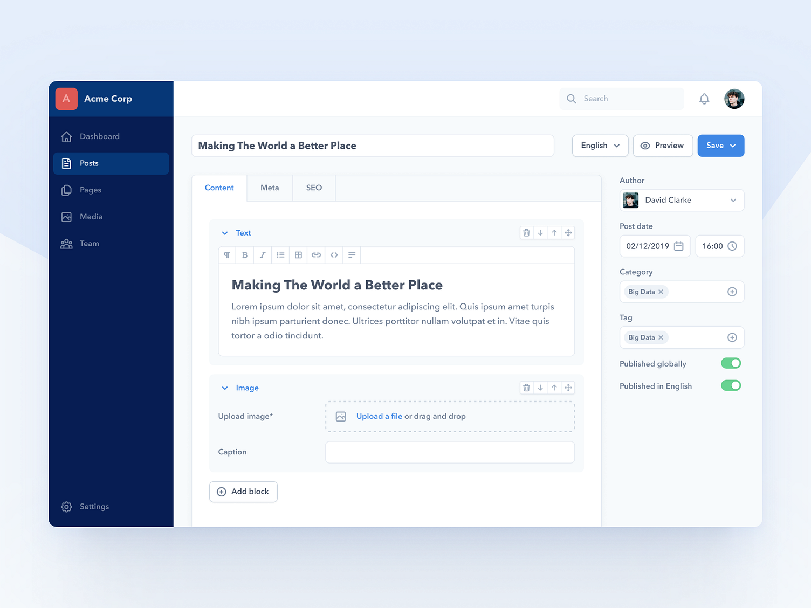

# R1 — CMS Design

Автор: **Jurgen Ploeger**.

Источник: [Dribbble, shot 10475418](https://dribbble.com/shots/10475418-CMS-Design).

## Что видно

Форма публикации с боковой навигацией. Заголовок, язык, preview и сохранение
находятся сверху. Контент отделён от метаданных и SEO. Текстовые и графические
блоки имеют собственные заголовки и действия. Справа — автор, дата, категория,
теги и параметры публикации.

## Как применять

- Основной ориентир для редактора статьи и блоков продукта.
- Содержание занимает главный столбец, свойства — вспомогательный.
- У блока есть тип, краткое название, порядок и явные действия.
- Язык контента и действия над всем материалом не прячутся внутри блока.

## Что адаптировать

Только существующие поля и типы блоков AI DEF. Не создавать SEO-поля,
локальную публикацию по языкам или свободный конструктор из-за их присутствия
на картинке. В AI DEF публикация относится к агрегату материала. На узком
экране свойства становятся отдельной вкладкой.

Применение подробно задано в разделах редактора и блога
[UI/UX-спецификации](../../02-ui-ux-spec.md).
