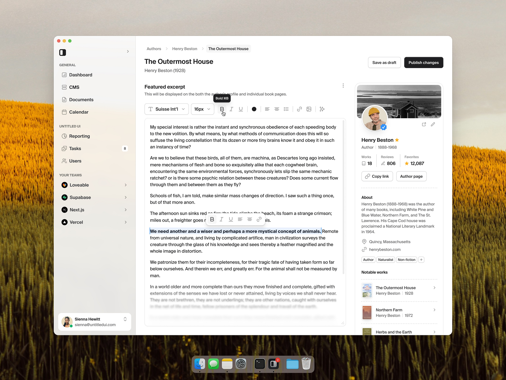

# R2 — CMS edit — Untitled UI

Автор: **Jordan Hughes**.

Источник: [Dribbble, shot 26333078](https://dribbble.com/shots/26333078-CMS-edit-Untitled-UI).

## Что видно

Светлая форма редактирования профиля книги. Навигация и хлебные крошки отделены
от содержания; типографика подчёркивает заголовок и рабочие поля. Сохранение
черновика и публикация — разные действия. Справа показан контекст связанной
записи.

## Как применять

- Базовый визуальный язык всей CMS: спокойные поверхности и ясная иерархия.
- Один основной акцент действия на экран, вторичные действия нейтральные.
- Читаемый текст, одинаковые поля, предсказуемые отступы и видимый фокус.
- Контекст материала рядом с формой, без декоративной статистики.

## Что адаптировать

Сохранить логотип AI DEF и установленный Inter. Использовать существующие
компоненты проекта. Не устанавливать Untitled UI, не покупать набор и не
переносить книжные карточки или фотографии. Светлая тема задаётся локальными
токенами CMS и не меняет публичную витрину.

Последующий запрос пользователя: максимально близкая адаптация именно R2
в тёмной теме. Поэтому прежнее требование светлой темы выше заменено графитовой
палитрой с сохранением композиции референса. Актуальные снимки и проверка экранов:
[отчёт](../../05-implementation-report.md).

Точные размеры и состояния первоначального задания — в разделе визуальной системы
[UI/UX-спецификации](../../02-ui-ux-spec.md).
