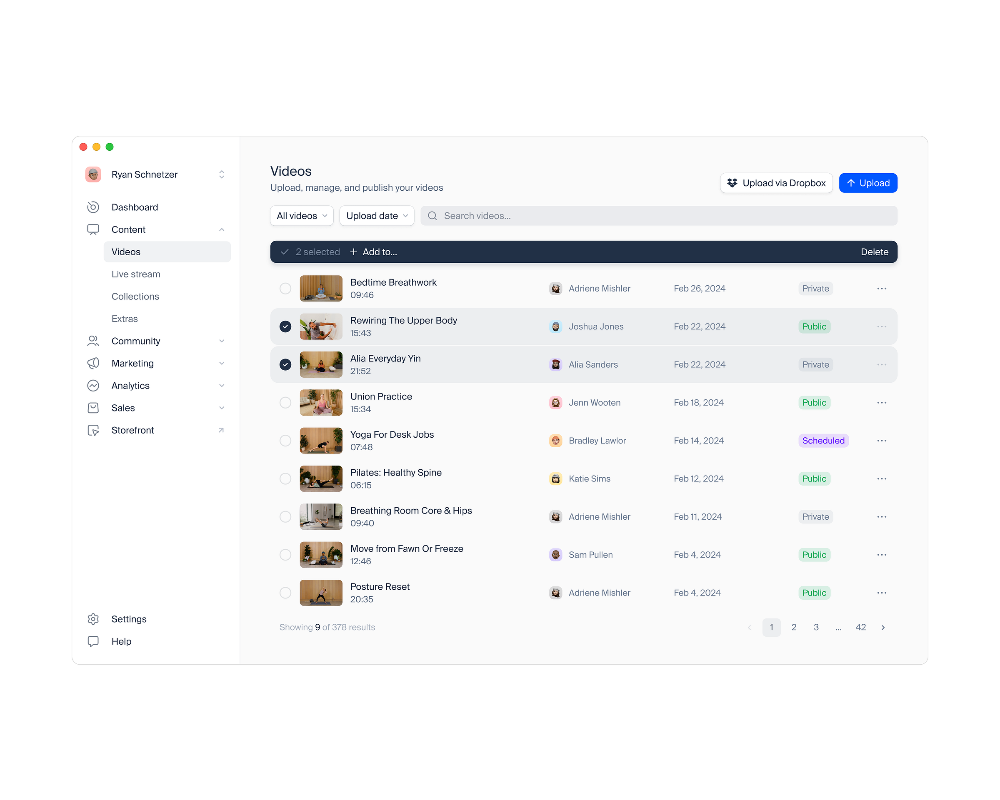

# R3 — Video CMS for Uscreen

Автор: **Danilo Tanic**, команда **FineTune**.

Источник: [Dribbble, shot 24405676](https://dribbble.com/shots/24405676-Video-CMS-for-Uscreen).

## Что видно

Список видео с миниатюрами, названием, автором, датой и состоянием публикации.
Над таблицей — поиск, фильтры и загрузка. При выборе строк появляется панель
массовых действий. Состояния различаются текстовыми метками.

## Как применять

- Основной ориентир для списков продуктов и статей.
- Компактные строки с полезным превью, стабильными колонками и заметным названием.
- Поиск и фильтры образуют один рабочий ряд.
- Состояние и дата читаются без открытия карточки.
- Пагинация показывает объём результатов и текущий диапазон.

## Что адаптировать

В первой реализации AI DEF нет чекбоксов и панели массовых действий: API
массовой операции отсутствует. Не добавлять фиктивные кнопки, Dropbox,
планирование публикации или колонки, для которых сервер не выдаёт данных.
Клавиатурное открытие материала остаётся обычной ссылкой.

Фильтры, пагинация и возврат в список заданы в
[UI/UX-спецификации](../../02-ui-ux-spec.md).
