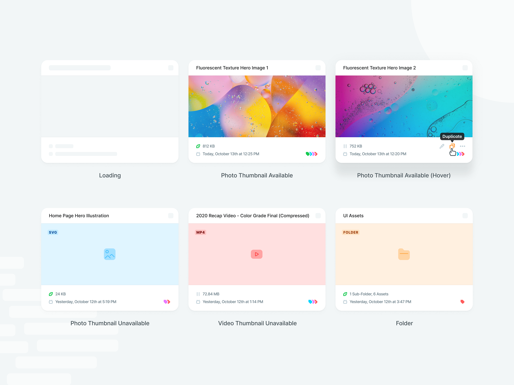

# R4 — Contentstack CMS Design System — Media Cards (Finalized)

Автор: **Max Burnside**.

Источник: [Dribbble, shot 15606377](https://dribbble.com/shots/15606377-Contentstack-CMS-Design-System-Media-Cards-Finalized).

## Что видно

Набор состояний медиакарточек: загрузка, доступное фото, действия при наведении,
нет миниатюры изображения, нет миниатюры видео, папка. Карточки содержат имя,
тип, размер и дополнительные сведения.

## Как применять

- Одна структура карточки для изображений, видео и PDF.
- Фиксированное место превью и понятная замена отсутствующей миниатюры.
- Отдельные состояния загрузки, ошибки и готовности.
- Действия доступны при фокусе и касании, не только hover.
- Название файла не исчезает при ошибке превью.

## Что адаптировать

Медиатека AI DEF переиспользует `cms.MediaAsset`. Папки, управление облачным
хранилищем, переименование и физическое удаление файлов не входят в задачу.
Alt остаётся свойством использования изображения и языка, а не глобальным
свойством файла. Старые файлы материала не объявляются потерянными из-за
отсутствия записи в новой медиатеке.

Модель выбора, ограничения файлов и API — в спецификации и
[плане реализации](../../03-implementation.md).
