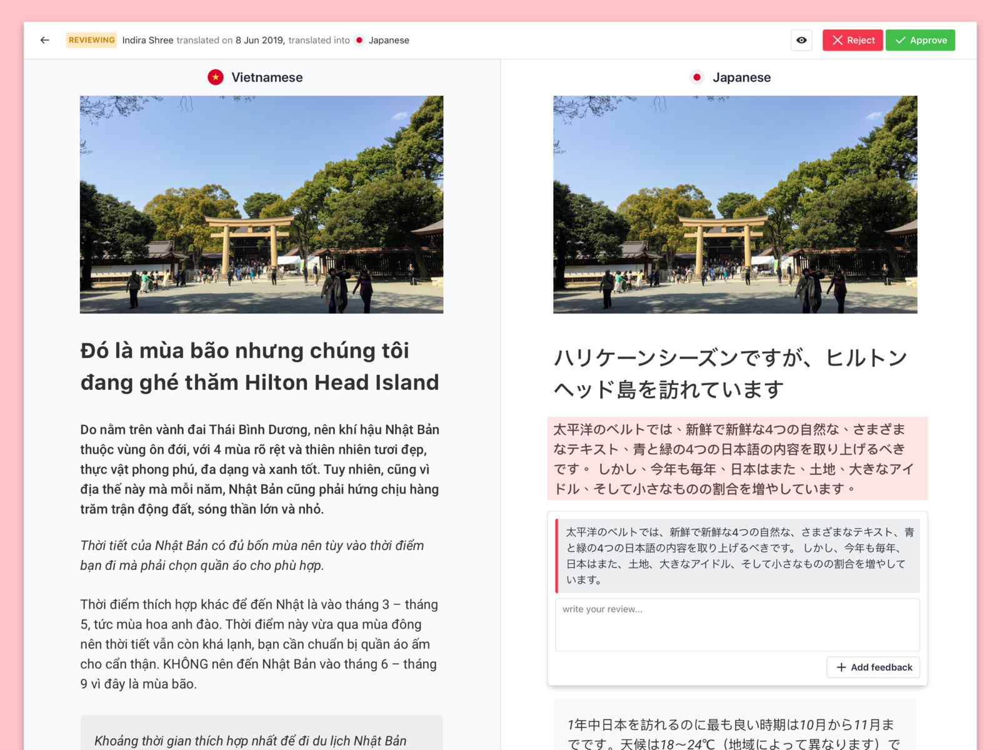

# R5 — W2K CMS — Article localization review editor

Автор: **Thuan Nguyen**.

Источник: [Dribbble, shot 6574067](https://dribbble.com/shots/6574067-W2K-CMS-Article-localization-review-editor).

## Что видно

Оригинал и перевод расположены рядом. Отдельный фрагмент перевода выделен,
рядом показаны отзыв и поле комментария. Автор описывает разделение обзорного
экрана и редактора.

## Как применять

- Режим сравнения EN с выбранным языком текущего материала.
- Явные подписи языка и одинаковый порядок смысловых полей.
- Английский оригинал доступен для чтения рядом с переводимым полем.
- Пустой перевод отличается от текста, показанного по fallback.

## Что адаптировать

Комментарии, согласование и статусы «проверено переводчиком» не добавляются.
В узком интерфейсе оригинал открывается над соответствующим полем. Общие
связи, порядок блоков, файлы и slug не дублируются по языкам. Незаполненный
перевод нельзя автоматически заполнять английским при простом просмотре.

Шесть языков AI DEF и семь ARMS берутся из действующего контракта. Полное
поведение описано в разделе переводов
[UI/UX-спецификации](../../02-ui-ux-spec.md).
